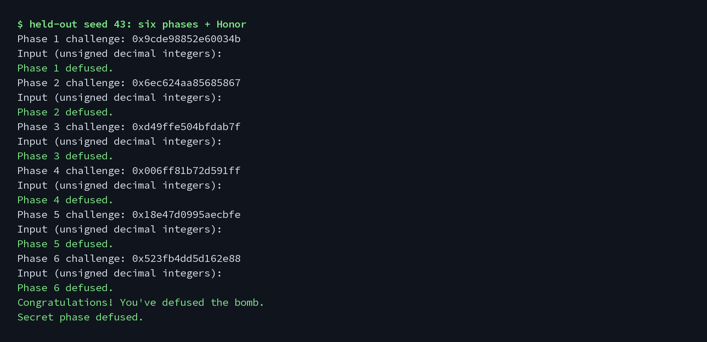

# BombLab 实验报告

个人炸弹版本：2026fall-v1  
分析对象 SHA-256：`ecbbf2c8f382cd638e762e4494f41bff160ad80c87ea0c7da720914fdccf47b7`

## 1. 方法和边界

本次分析以个人 `bomb` 的实际 ELF 为准。先用 `file`、`readelf`、`nm` 和 `strings` 检查文件类型、导入符号和可能的副作用，再用 `objdump -d -M intel` 看控制流。二进制是 Linux x86-64 ELF，只动态依赖 libc；导入表里没有网络、文件打开、进程创建或提权函数。实际运行阶段只在本地 WSL 中读标准输入、写标准输出/错误，并设置短超时。

下面所有算术都按 `uint32_t` 回绕。`c` 表示当前关的 64 位 challenge，`lo=(uint32_t)c`，`hi=(uint32_t)(c>>32)`。

## 2. Phase 1：三段函数调用

关键汇编在 `p1_compute` 和三个小函数：

```asm
40205b: mov    r8d,edi          ; lo
40205e: shr    rax,0x20         ; hi = c >> 32
402062: shr    rdx,0x10         ; c >> 16
402066: mov    r9d,eax          ; preserve hi
40206e: call   p1_step0
402079: mov    ecx,eax          ; save step 0
40207b: call   p1_step1
402085: call   p1_step2
40208b: xor    eax,ecx
```

三个步骤分别恢复成：

```text
a = 3 * (lo - hi) + 0xdf00
b = 4 * hi + ((uint32_t)(c >> 16) ^ 0x0b1a)
d = (lo + 0x2984) ^ b
answer = d ^ a
```

`phase_01` 只读一个无符号整数并与这个结果比较，所以输出 `answer` 一项。

## 3. Phase 2：六项递推

入口先要求六个整数。`0x40215a` 到 `0x40216a` 从 challenge 的第 35 位开始取 5 位，再乘 3，得到首项。循环每次把移位量加 3，并把前一项乘 4：

```asm
40215d: shr    rax,0x23
402164: and    eax,0x1f
402167: lea    eax,[rax+rax*2]
...
40217b: shr    rax,cl
40217e: and    eax,0xf
402181: xor    eax,edx
402183: lea    eax,[rax+rsi*4]
```

因此：

```text
v[0] = 3 * ((c >> 35) & 0x1f)
v[i] = 4 * v[i-1] + (((c >> (11 + 3*(i-1))) & 0xf) ^ i), i=1..5
```

输出顺序就是 `v[0]` 到 `v[5]`。

## 4. Phase 3：跳转表

第一项必须等于 `lo & 7`。第二项的输入先折叠 challenge：

```text
selector = lo & 7
x = hi ^ (uint32_t)(c >> 3)
```

`p3_dispatch` 在 `0x405820` 处按 selector 查跳转表。表项对应的 case 顺序是 `[5,4,2,0,3,6,1,7]`，各 case 的计算是：

```text
case0: 2*x ^ 0x1c6e        case1: (x ^ 0xf90c) + (x >> 2)
case2: 5*x + 0x381c6       case3: 3*x + 0xc817
case4: 5*x + 0x1104        case5: 5*x + 0x27fdd
case6: 2*x ^ 0xaa7a        case7: (x ^ 0xec59) + (x >> 2)
```

所以答案是 `selector` 和跳转到的 case 结果。这里没有把某几个 seed 的答案写死，公开列表之外的 selector 也走同一套分派。

## 5. Phase 4：二分递归

`phase_04` 取 `target=lo&0x7f`，并把 `key=(uint32_t)(c>>7)^hi` 传给 `p4_walk(target,0,127,key)`。关键分支是：

```asm
40232e: cmp    edi,eax          ; middle vs target
402330: je     402380
402340: jb     402360           ; target < middle
...
402356: xor    eax,0x3          ; right branch
...
402374: xor    eax,0x16         ; left branch
402380: lea    eax,[rdi+0xea]   ; base case
402386: xor    eax,ecx
```

递归关系写成：

```text
mid = low + ((high-low)>>1)
F(target,low,high,key) =
  (mid+0xea)^key                                      , target==mid
  (3*F(target,low,mid-1,key) ^ (mid+key)) ^ 0x16     , target<mid
  (3*F(target,mid+1,high,key) ^ (mid+key)) ^ 0x03    , target>mid
```

输出一项 `F(target,0,127,key)`。直接 challenge 测试把 0 到 127 的所有 target 都跑了一遍。

## 6. Phase 5：链表遍历

`p5_traverse` 先用 `c&7` 在 `0x405b60` 选链表头。节点从 `0x405ba0` 开始，每项正好 16 字节：`value`、`tag`、`next`。八个表头换成节点下标后是：

```text
[9, 7, 11, 2, 10, 4, 6, 3]
```

汇编中的初值和折叠循环是：

```asm
40242f: shr    rdi,0x20
402433: shr    rax,0x6
402437: xor    eax,edi
40243e: xor    eax,0x78f1
402443: lea    eax,[rax+rax*2]
402446: add    eax,DWORD PTR [rdx]
40244b: xor    eax,esi
...
40245b: lea    eax,[rax+rax*2]
402464: add    eax,DWORD PTR [rdx]
402466: xor    eax,esi
```

先算：

```text
acc = 3 * (((uint32_t)(c>>6) ^ hi) ^ 0x78f1)
acc = (acc + head.value) ^ head.tag
steps = (c>>3) & 3
```

之后沿 `next` 走 `steps` 次，每到新节点更新 `acc=(3*acc+value)^tag`。最后输出 `acc` 和末节点 `tag`。节点常量直接来自这个个人 ELF 的 `.rodata`，代码没有使用公开 seed 答案表。

## 7. Phase 6：函数指针表

`p6_dispatch` 的输入折叠为 `x=(uint32_t)(c>>6)^hi`。第一次按 `c&7` 选操作，异或 `0xb4b5`，再按 `(c>>3)&7` 选第二个操作，最后加 `0x5c7e`：

```asm
402596: call   QWORD PTR [rax*8+0x405e00]
40259d: xor    eax,0xb4b5
4025a4: call   QWORD PTR [rbx+0x405e00]
4025af: add    eax,0x5c7e
```

函数指针表对应操作编号 `[5,3,3,4,0,1,2,0]`。六个操作为：

```text
op0(x) = (x+0x9e76) ^ (x>>5)
op1(x) = ror32(x,7)
op2(x) = ((x>>3)^x) + 0x077c
op3(x) = ((x<<5)+0x1481) ^ (3*x)
op4(x) = (x^0x9c0f) + (x<<5)
op5(x) = rol32(x,7) ^ 0x29d2
```

直接 challenge 测试覆盖了低 6 位的 64 种组合，也就是两次间接调用的全部表项组合。

## 8. Honor：相邻字段覆盖

`secret_gate` 在栈上清零一块局部对象，缓冲区从 `rbp-0xd0` 开始。它要求输入长度在 36 到 163 字节，然后用 `secret_copy` 逐字节复制。比较位置是 `rbp-0xb0`，刚好比缓冲区开头多 32 字节：

```asm
402761: sub    rax,0x24
402765: cmp    rax,0x7f
402780: mov    rsi,rbx
402783: mov    rdi,r12
402786: call   secret_copy
40278b: cmp    DWORD PTR [rbp-0xb0],0x4e45504f  ; "OPEN"
40279d: lea    rdi,[rbp-0xac]                    ; first byte after OPEN
4027a4: call   secret_phase
```

因此前 32 字节可作填充，第 32..35 字节必须是 `OPEN`，其后放三个十进制整数。令：

```text
cf = (uint32_t)challenge ^ (uint32_t)(challenge>>32)
xf = (uint32_t)context   ^ (uint32_t)(context>>32)
n0 = context & 3
mix(z) = (rol32(z,1)+0x02ca) ^ 0xe0ac
n1 = mix(cf^xf) ^ ((uint32_t)(context>>16) ^ (n0*0x02ca))
n2 = n1 ^ (xf+n0+0xe0ac+(cf>>1))
```

最终第七行格式是 32 个 `A`，紧跟 `OPEN`，再紧跟 `n0 n1 n2`。`context` 由驱动根据前六行口令计算；Honor 不能只看 secret challenge。

## 9. 验证结果

- `make defuser`：GCC 使用 `-Wall -Wextra -Wpedantic -Werror` 编译通过。
- 冻结模板 `make test`：正式关卡公开测试 `60/60`，Honor 公开测试 `10/10`。
- 公开列表外 seed `43`：六关逐关通过；六关整套加 Honor 通过并出现 `Secret phase defused.`。
- 可复现的直接 challenge 分支套件：Phase 3 全部 8 个 selector，Phase 4 全部 128 个 target，Phase 5 的 32 种头/步数组合，Phase 6 的 64 种函数表组合，加上 Phase 1/2 各 5 个边界值，共 `242/242` 通过。生成器、精确命令、242 项 manifest 和逐项 stdout/返回码结果分别保存在 `evidence/run_branch_suite.py`、`branch-suite-command.txt`、`branch-suite-cases.json` 和 `branch-suite-results.json`；运行时先锁定 `defuser.c`、已测试 solver 与 bomb 的 SHA-256，并记录 WSL2/Python/glibc 身份。

下面图片由保存下来的真实 stdout 日志直接排成等宽图片，没有手写改动输出内容。



## 10. 工具、引用和 AI 使用说明

使用的本地工具：`file`、`readelf`、`nm`、`strings` 用于静态安全检查；`objdump` 用于反汇编和只读数据检查；GCC/Make 用于编译；模板自带 `public_test.py` 用于公开测试。没有联网搜索具体答案，也没有使用其他同学代码或固定 seed 答案表。

本报告与 `defuser.c` 是 AI 助手基于提供的个人二进制完成静态分析、公式恢复、代码草拟、本地测试和报告草拟后生成的草稿。这里不把上述过程描述成学生本人独立完成的分析。提交前，学生需要逐关阅读汇编和源码、亲自复现验证命令、确认课程公告允许这种 AI 使用范围，并保证能解释每个公式和实现细节。

参考资料：

- [1] ICS 2026 Fall BombLab 课程实验说明与冻结模板 `README.md`，模板提交 `8ee40e2e257aa7535943adbef4472f039d748eff`。
- [2] GNU Binutils `objdump` 手册，本地 `man objdump`。
- [3] CS:APP x86-64 GDB 速查表，`http://csapp.cs.cmu.edu/3e/docs/gdbnotes-x86-64.pdf`。
- [4] System V AMD64 的寄存器传参约定，结合 ELF 符号与反汇编调用点使用。

## 11. 小结

六个正式关卡都恢复为 challenge 的通用计算，不依赖公开 seed。Honor 同时使用 secret challenge 和前六行得到的 context。现有本地证据覆盖公开测试、一个公开列表外 seed 和主要控制流分支；最终提交前仍应由学生自己复核并解释。
